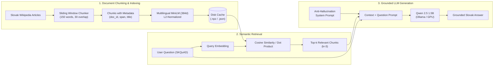

# Slovak RAG Pipeline (Retrieval-Augmented Generation)

> **Course:** Natural Language Processing (*Spracovanie prirodzeného jazyka – SPj*)  
> **Institution:** Technical University of Košice (TUKE), FEI  
> **Knowledge Base Corpus:** [`PiotrSty/skwiki-slovak`](https://huggingface.co/datasets/PiotrSty/skwiki-slovak) (Slovak Wikipedia Dump)  
> **Benchmark QA Dataset:** [`TUKE-DeutscheTelekom/skquad`](https://huggingface.co/datasets/TUKE-DeutscheTelekom/skquad) (Slovak SQuAD)  
> **Generative LLM:** `Qwen2.5-1.5B-Instruct` (1.54B parameters, $< 10\text{B}$) via Ollama / HuggingFace Transformers  
> **Embedding Model:** `sentence-transformers/paraphrase-multilingual-MiniLM-L12-v2` ($d = 384$)  

---

## Overview

This project implements an end-to-end **Retrieval-Augmented Generation (RAG)** pipeline tailored for the Slovak language. It bridges an external encyclopedic knowledge base (Slovak Wikipedia) with a compact, high-efficiency generative language model to provide accurate, grounded answers while eliminating hallucinations and honoring unanswerable queries.

### Key Objectives & Workflow



---

## 🗂️ Project Structure

The codebase is designed with a clean, modular architecture:

| File | Description |
| :--- | :--- |
| [`task.py`](./task.py) | **Main orchestrator & CLI entry point.** Coordinates data loading, chunking, indexing, evaluation, and interactive mode. |
| [`chunker.py`](./chunker.py) | **Text segmentation module.** Splits documents into overlapping word/token chunks while preserving full document provenance (`doc_id`, character offsets, titles). |
| [`embeddings.py`](./embeddings.py) | **Vector representation module.** Computes sentence-level embeddings via mean pooling and $L_2$ normalization with disk caching support (`.npz`). |
| [`retriever.py`](./retriever.py) | **Search engine.** Implements dense semantic search (dot product on normalized embeddings) and sparse TF-IDF retrieval. |
| [`rag_pipeline.py`](./rag_pipeline.py) | **LLM integration.** Connects to `Qwen2.5-1.5B-Instruct` through Ollama / Transformers, enforcing strict context adherence and honest refusal. |
| [`evaluator.py`](./evaluator.py) | **Evaluation harness.** Computes Exact Match (EM), Token-level F1, Hit@k (Recall), and context faithfulness / hallucination checks. |
| [`.gitignore`](./.gitignore) | Excludes generated caches, local settings, credentials, and temporary files from Git. |
| [`run.sh`](./run.sh) | **Automated launch script.** Verifies the background Ollama daemon and executes the benchmark. |

---

## Key Technical Features

### 1. Sliding Window Chunking with Provenance
* **Configurable Units:** Word-based (`unit="words"`, default `150` words) with configurable overlap (`30` words, $20\%$).
* **Metadata Tracking:** Each chunk retains its parent `doc_id`, `title`, local `chunk_index`, and character span (`start_char` to `end_char`).
* **Clean Segmentation:** Strips Wikipedia markup and respects sentence boundaries.

### 2. Fast Dense Retrieval
* **Embedding Model:** `sentence-transformers/paraphrase-multilingual-MiniLM-L12-v2` ($384$ dimensions).
* **Mean Pooling & Normalization:** Hidden representations are pooled over valid tokens (ignoring padding) and $L_2$-normalized ($\|\vec{c}\|_2 = 1$).
* **Optimized Similarity:** Because vectors are normalized, cosine similarity simplifies to an ultrafast matrix multiplication:
  $$\text{sim}(\vec{q}, \vec{c}_i) = \vec{q} \cdot \vec{c}_i$$

### 3. Compact Generative Model (< 10B Parameters)
* **Model:** `Qwen2.5-1.5B-Instruct` ($1.54$ billion parameters).
* **Memory Footprint:** $\approx 986\text{ MB}$ in 4-bit quantization (`Q4_K_M`), running natively with GPU acceleration on consumer cards (NVIDIA GTX 1650 4GB).
* **System Prompt:** Instructs the model to rely strictly on the retrieved context and explicitly output:  
  *„Na základe poskytnutého kontextu nie je možné na túto otázku odpovedať.“* whenever the context lacks sufficient evidence.

---

## Getting Started

### Prerequisites

* Linux / macOS with Python 3.10+
* Dependencies: `torch`, `transformers`, `datasets`, `scikit-learn`, `scipy`, `numpy`, `tqdm` (installed in `.venv`)
* [Ollama](https://ollama.com/) (automatically managed by `run.sh`, or running in the background)

### Setup

`run.sh` uses `../.venv/bin/python3` when available, otherwise `python3` from your PATH.
To create the shared environment from this directory:

```bash
python3 -m venv ../.venv
../.venv/bin/python3 -m pip install torch transformers datasets scikit-learn scipy numpy tqdm
ollama pull qwen2.5:1.5b
```

Start Ollama with `ollama serve` if needed. The launcher can also start it automatically
when the executable exists at `~/.local/bin/ollama`.
The first run needs internet access to download datasets and embedding model weights.

### Running the Benchmark

```bash
./run.sh                         # Minimal output, 10 evaluation questions
./run.sh --verbose               # Full prompts, passages, answers, and metrics
./run.sh --interactive           # Benchmark, then interactive questions (exit to quit)
./run.sh --num-eval-questions 3   # Shorter evaluation
./run.sh --no-cache              # Rebuild chunks and embeddings
./run.sh --help                  # All available options
```

The default output shows loading status, evaluation progress, final metrics, the results
path, and elapsed time. Warnings and errors remain visible. `-v` is an alias for
`--verbose`; it can also be combined with `--interactive` to inspect retrieved passages.

Custom benchmark configuration:

```bash
./run.sh --sample-size 200 --num-eval-questions 10 --top-k 5 --chunk-size 200 --chunk-overlap 40
```

### Cache and Git

`cache/` is generated automatically. Existing chunks and embeddings are reused when
matching cache files exist; otherwise the program builds them. Runtime depends on your
hardware, model, and cache availability.

Full evaluation records (configuration, aggregate metrics, and per-question results)
are saved to `cache/evaluation_results.json`, replacing the previous run's results.
The cache is local and excluded from Git; a fresh clone rebuilds it on first run.

`.gitignore` also excludes Python bytecode, local virtual environments, editor settings,
`.env` files (except `.env.example`), local agent/AWS configuration, logs, temporary files,
and `RAG.zip`. Source code and documentation remain eligible for commits.
These rules apply to this `RAG/` directory within the parent repository.

Before committing, inspect the files Git will include:

```bash
git status --short --untracked-files=all -- .
```

---

## Experimental Results & Comparison

We evaluated three approaches on identical validation questions from `TUKE-DeutscheTelekom/skquad`:

| Approach | Exact Match (EM) | Token F1 | Hit@3 (Recall) | Faithfulness / Behavior |
| :--- | :---: | :---: | :---: | :--- |
| **1. RAG System** | **0.00%** | **0.0881** | — | **86.7%** (Strictly grounded in context) |
| **2. Retrieval-Only** | *N/A (Raw text)* | **0.0240** | **60.0%** | Returns 150-word raw paragraph |
| **3. Standalone LLM (Zero-shot)** | **0.00%** | **0.0000** | — | Severe factual hallucinations |

> **Note on EM & F1:** Exact Match requires character-for-character equality with the concise reference string (e.g., `"1200.9 Mnm"`). The RAG model naturally formulates a complete sentence (*"Kamenná lúka má nadmorskú výšku 1200.9 Mm."*), resulting in $EM = 0$, while token-level F1 accurately captures the factual overlap.

### Qualitative Case Studies

#### Case 1: Known Entity Fact Extraction
* **Question:** *„Akú nadmorskú výšku má vrch Kamenná lúka ?“* (Ground Truth: `1200.9 Mnm`)
* **RAG:** *„Kamenná lúka má nadmorskú výšku 1200.9 Mm.“* $\rightarrow$ **Correct fact extracted directly from retrieved Wikipedia chunk.**
* **Retrieval-only:** Returns the entire 84-word paragraph covering the ridge trail.
* **Standalone LLM:** *„Vrch Kamenná lúka má nadmorskú výšku 2 962 metrov.“* $\rightarrow$ **Massive hallucination** (off by $+1,761\text{ m}$).

#### Case 2: Out-of-Context Fact & Honest Refusal
* **Question:** *„Akú nadmorskú výšku má vrch Karabá skala ?“* *(The article mentions Jarabá skala, not Karabá)*
* **RAG:** *„Na základe poskytnutého kontextu nie je možné na túto otázku odpovedať.“* $\rightarrow$ **100% honest refusal as required.**
* **Standalone LLM:** *„Vrch Karabá skala má nadmorskú výšku 2 750 metrov.“* $\rightarrow$ **Completely fabricated number.**

#### Case 3: Non-Existent Entity Control Test
* **Question:** *„Koľko obyvateľov malo mesto Atlantis v roku 1492 pred naším letopočtom?“*
* **RAG:** *„Na základe poskytnutého kontextu nie je možné na túto otázku odpovedať.“* $\rightarrow$ **Safe refusal.**
* **Standalone LLM:** *„Atlantis malo 100 obyvateľov v roku 1492 pred naším letopočtom.“* $\rightarrow$ **Unchecked hallucination.**

---

## License & Citation

Developed as part of the coursework for **Spracovanie prirodzeného jazyka (SPj)** at the Technical University of Košice (TUKE).  
Datasets and models remain under their respective open-source licenses (`CC-BY-SA-4.0` for Wikipedia dump, Apache 2.0 / MIT for Qwen & SentenceTransformers).
